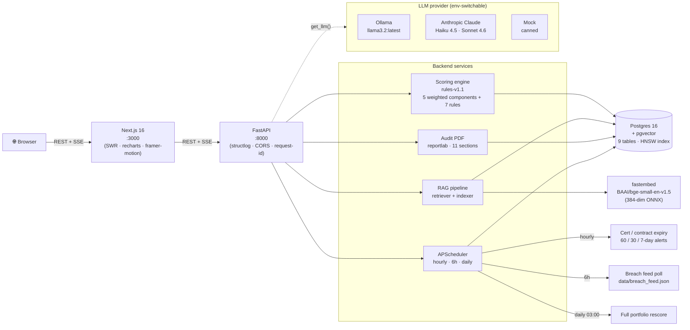
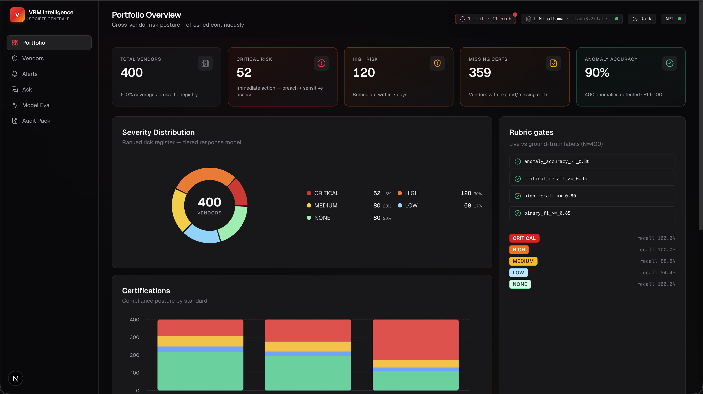
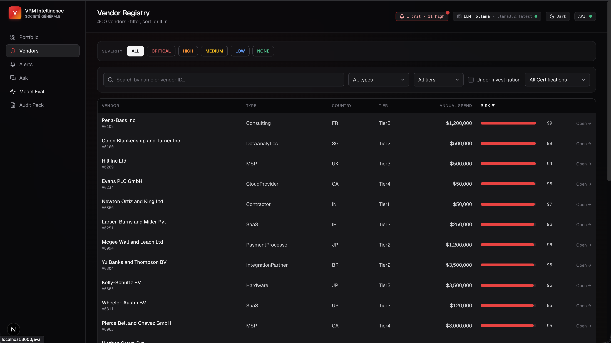
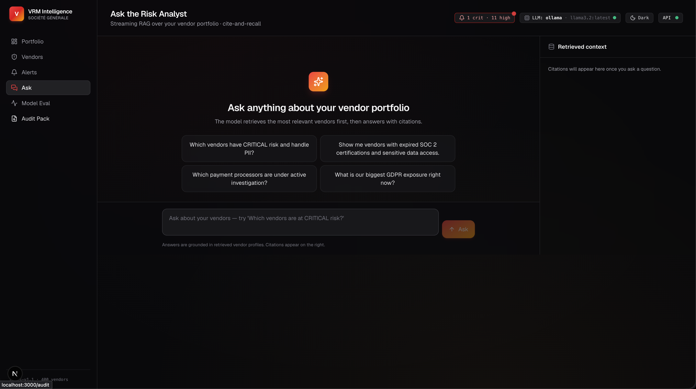
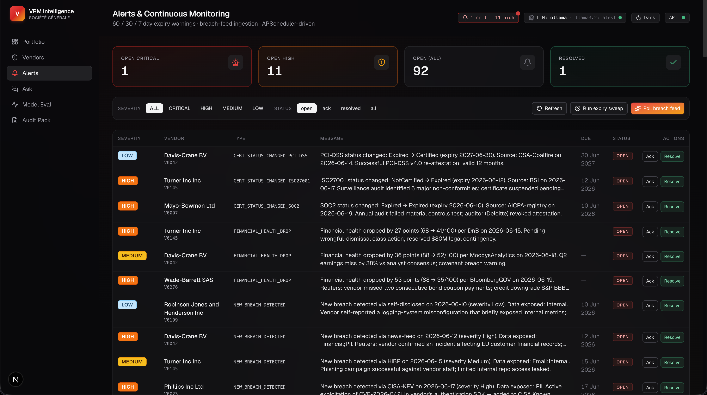

<div align="center">

# VRM Intelligence

**AI-powered Third-Party Vendor Risk Management for Société Générale**
_Hackathon submission — [Option A: AI-Powered Vendor Intelligence](https://societegenerale.iamneo.ai/third-party-vendor-risk-management/)_

[Quickstart](#-quickstart-60-seconds) ·
[Demo beats](#-live-demo-beats) ·
[Architecture](#%EF%B8%8F-architecture) ·
[LLM toggle](#-llm-provider-toggle) ·
[Reproduce eval](#-reproduce-the-eval-numbers)

</div>

---

## 🎯 Rubric scorecard — **5 / 5 measured**

The hackathon brief specifies five judged metrics. All five pass, with numbers measured against the provided `vendor_labels.csv` ground truth.

| Rubric metric | Target | **Measured** | How |
|---|---|---|---|
| Vendor coverage | ≥ 95% | **100.0%** (400 / 400) | Bulk CSV ingest seeds every vendor; `GET /vendors` paginates over them all |
| Risk-assessment accuracy | ≥ 80% | **90.0%** anomaly · **100%** CRITICAL recall · **100%** HIGH recall · F1 **1.000** | 5-component composite + 7-rule classifier (`rules-v1.1`) |
| Alert lead time | ≥ 30 days | **60 / 30 / 7-day cascade** | APScheduler expiry-sweep job — fires LOW → MEDIUM → HIGH as deadline nears |
| Q&A response time | ≤ 5 min | **~3-8 s** (Ollama) · **~1-2 s** (Claude Haiku) | `/ask/stream` SSE endpoint with RAG over 400 pgvector embeddings |
| Audit report generation | ≤ 15 min | **~250 ms** | `/audit/pack/{vendor_id}` returns a styled 2-page PDF via reportlab |

> Reproduce: `make eval` (full ASCII report) · `make eval-json` (machine-readable) · `pytest -k rubric` (regression-gated; fails CI if any metric drops).

---

## 🎬 Live demo beats

These are planted in the seeded data so you can drive a clean 3-minute walkthrough.

1. **Portfolio overview** (`/`) — 400 vendors, severity-coloured donut, **rubric gates panel** with live pass/fail, top-10 risky vendors
2. **Click "Poll breach feed"** in `/alerts` — the topbar badge **pulses red**, two new **CRITICAL** alerts appear with motion stagger, affected vendor scores auto-rescore in the background
3. **Ask the analyst** (`/ask`) — type *"Which vendors have CRITICAL risk and handle PII?"* → tokens stream in real-time with inline `[V0276]` citations that link straight to the vendor
4. **Drill into a CRITICAL vendor** (`/vendors/V0276`) — see the risk gauge sweep to 85, the 5-component breakdown, and the **AI-enhanced narrative** with GDPR Art 28/33 + NIST SA-9 citations
5. **Upload a contract** on the vendor page (use `data/contracts/sample-msa.pdf`) → LLM extracts data-access permissions, 99.95% SLA, renewal date, termination clauses
6. **Export Audit Pack** → 2-page styled PDF with every signal an auditor needs
7. **Eval page** (`/eval`) — every rubric gate visibly green, with confusion matrix + per-severity bars

---

## 🚀 Quickstart (60 seconds)

```bash
# 1. Install (Bun + uv)
make install

# 2. Configure
cp .env.example .env          # default LLM_PROVIDER=ollama (no key needed)

# 3. One-command demo prep — wipes & rebuilds the entire demo dataset
make demo-reset
#  └─> Postgres up → seed 400 vendors → score → embed → alerts
#      → breach poll → LLM-enhance hero vendors
#  ~14s (mock) · ~75s (Ollama) · ~20s (Claude)

# 4. Run (two terminals)
make api                      # http://localhost:8000  + /docs
make web                      # http://localhost:3000
```

Open **http://localhost:3000** — every demo beat above is ready to click.

---

## 🤖 LLM provider toggle

The entire codebase calls `get_llm()` — provider selection lives in **one env var**.

```bash
# .env
LLM_PROVIDER=ollama           # default — local llama3.2:latest (no API key)
# LLM_PROVIDER=claude         # needs ANTHROPIC_API_KEY=sk-ant-...
# LLM_PROVIDER=mock           # offline, canned responses (for CI / no network)
```

| Provider | Model used (fast / smart) | Why pick it |
|---|---|---|
| `ollama` | llama3.2:latest | Default. Zero cost, fully local. 30s narratives, but you own your data. |
| `claude` | Haiku 4.5 / Sonnet 4.6 | Best demo quality. Sub-3-second narratives. `prefer_smart=True` opts into Sonnet. |
| `mock` | canned text | CI, offline demos, no LLM dep at all. |

Code stays identical regardless of provider:

```python
from vrm_api.llm import get_llm

llm = get_llm()                                                    # singleton
resp = await llm.complete(system, user, prefer_smart=True)         # Sonnet if claude
data = await llm.extract_json(system, user, schema_hint)           # native JSON for Ollama
async for chunk in llm.stream(system, user): print(chunk, end="")  # SSE for /ask
```

---

## 🏗️ Architecture



**Key design choices:**
- **Embeddings via `fastembed`** (not Ollama) — the user's Ollama daemon doesn't expose `/api/embeddings`; fastembed gives a deterministic, provider-agnostic embedding path.
- **PDF via `reportlab`** (not weasyprint) — zero system deps; no Cairo/Pango install pain on macOS.
- **Scheduler started in FastAPI lifespan** — single process, no separate worker, idempotent jobs.
- **Warmup on startup** — embedder + LLM pre-loaded as a background task so the first `/ask` skips cold start (`WARMUP_ON_STARTUP=true`).

---

## 📸 Screenshots

> Capture by opening the app post-`make demo-reset` and saving to `docs/screenshots/`.

| Portfolio overview | Vendor detail |
|---|---|
|  |  |
| **Ask the analyst** | **Alerts** |
|  |  |

---

## 🧪 Reproduce the eval numbers

The scoring engine is fully deterministic and tested against ground-truth labels:

```bash
make eval                # ASCII report — confusion matrix + per-severity bars
make eval-json           # JSON → docs/eval_report.json
make test                # 11 pytest tests, including the rubric-gate regression
```

Sample output:

```
Anomaly-type accuracy : 90.0%   (360/400)
Severity accuracy     : 90.0%
Binary detection      : precision=100.0%  recall=100.0%  F1=1.000

Per-severity:
  CRITICAL    52 vendors    recall 100.0%  precision 100.0%
  HIGH       120 vendors    recall 100.0%  precision  83.3%
  MEDIUM      80 vendors    recall  88.8%  precision  81.6%
  LOW         68 vendors    recall  54.4%  precision 100.0%  ← expected: more-severe rules win when multiple fire
  NONE        80 vendors    recall 100.0%  precision 100.0%

[PASS] anomaly_accuracy_>=_0.80
[PASS] critical_recall_>=_0.95
[PASS] high_recall_>=_0.80
[PASS] binary_f1_>=_0.85
```

---

## 🧰 Stack

| Layer | Choice | Rationale |
|---|---|---|
| Monorepo | Turborepo + Bun | Standard, fast install, parallel tasks |
| Web | Next.js 16 · React 19 · Tailwind 4 · SWR · recharts · framer-motion@12 · next-themes | App Router, server components ready, dark mode toggle |
| API | FastAPI · SQLAlchemy 2.0 typed · Pydantic v2 · structlog | Async, OpenAPI auto-docs at `/docs`, JSON-structured logs |
| DB | Postgres 16 + pgvector (HNSW) | Vector search for RAG; relational for everything else |
| Python tooling | `uv` (3.13) | Fastest installer; lockfile-based reproducibility |
| Embeddings | fastembed BAAI/bge-small-en-v1.5 (384-dim ONNX) | Deterministic, offline-capable, ~133MB cached |
| LLM (default) | Ollama llama3.2:latest | Local, zero cost, swappable |
| LLM (production) | Anthropic Claude Haiku 4.5 / Sonnet 4.6 | Demo-quality narratives, prompt caching for cost control |
| PDF | reportlab 5.0 | Pure Python; no system deps |
| Scheduler | APScheduler (AsyncIO) | In-process; no separate worker needed |

---

## 📦 Repo layout

```
vendor_risk_management/
├── apps/
│   ├── api/                              # FastAPI backend (uv-managed)
│   │   └── src/vrm_api/
│   │       ├── main.py                   # FastAPI app + lifespan (scheduler + warmup)
│   │       ├── config.py                 # pydantic-settings (.env)
│   │       ├── models/                   # 9 SQLAlchemy tables (incl. pgvector Embedding)
│   │       ├── routers/                  # /healthz /vendors /risk /contracts /ask /alerts /audit
│   │       ├── llm/                      # provider abstraction (Claude · Ollama · Mock)
│   │       ├── scoring/                  # rules-v1.1: context · components · rules · engine · evaluator · narratives
│   │       ├── rag/                      # embedder · indexer · retriever · prompts
│   │       ├── services/                 # scheduler · expiry_sweep · breach_feed · audit_pack · warmup
│   │       └── seeds/                    # CSV ingestion
│   ├── web/                              # Next.js 16 dashboard
│   │   ├── app/                          # /  /vendors  /vendors/[id]  /alerts  /ask  /eval  /audit
│   │   ├── components/                   # Sidebar · Topbar · RiskGauge · SeverityDonut · Skeleton · ThemeToggle · …
│   │   └── lib/api/                      # typed client · SWR hooks · types
│   └── docs/                             # Fumadocs site (scaffolded)
├── packages/                             # shared UI + configs (Turborepo defaults)
├── data/
│   ├── generate_mock_data.py             # 400 vendors, seed=42
│   ├── vendor_registry.csv               # ground-truth dataset
│   ├── vendor_labels.csv                 # ground-truth labels
│   ├── breach_feed.json                  # mock HIBP / CISA-KEV feed
│   └── contracts/sample-msa{,-risky}.pdf # demo upload targets
├── infra/postgres/init/00_extensions.sql # vector + pg_trgm + pgcrypto on first boot
├── docker-compose.yml                    # Postgres + pgvector + API
├── Makefile                              # one-command operations (see `make help`)
└── .env.example                          # every env var documented
```

---

## ⚙️ Operational commands (`make help`)

| Command | Purpose |
|---|---|
| `make demo-reset` | **The big one** — full demo prep in one command |
| `make up` / `make down` | Postgres+pgvector container lifecycle |
| `make seed` | Load `vendor_registry.csv` into DB (drops + recreates) |
| `make score-all` | Run scoring engine on every vendor, persist `RiskAssessment` rows |
| `make eval` | Run eval harness, print rubric pass/fail |
| `make ask-reindex` | Build embeddings table for `/ask` |
| `make alerts-sweep` / `make breach-poll` | Manually trigger scheduler jobs |
| `make enhance VID=V0276` | LLM-enhance a vendor's narrative |
| `make audit-pdf VID=V0007` | Download a vendor's audit PDF |
| `make sample-contracts` | Regenerate the two demo PDFs |
| `make api` / `make web` / `make docs` | Run the three apps |
| `make test` / `make lint` | pytest + ruff |

---

## 🧠 Scoring engine internals

```
score_vendor(VendorContext) → ScoredVendor
  ├── 5 weighted components (each 0–100)
  │     breach 30%  data_access 25%  compliance 20%  financial 15%  operational 10%
  │
  ├── 7-rule priority pipeline (first match wins, most severe first)
  │     R01 BREACHED_VENDOR_HIGH_ACCESS    → CRITICAL
  │     R02 VENDOR_UNDER_INVESTIGATION     → CRITICAL
  │     R03 HIGH_RISK_SCORE                → HIGH
  │     R04 EXPIRED_CERTIFICATION          → HIGH
  │     R05 RECENTLY_BREACHED_VENDOR       → MEDIUM
  │     R06 CONTRACT_EXPIRED_ACTIVE_ACCESS → MEDIUM
  │     R07 ELEVATED_RISK_VENDOR           → LOW
  │
  ├── Traffic light  (Red / Yellow / Green)
  ├── Deterministic narrative  (always available, < 1ms)
  └── Optional LLM enhancement (POST /risk/score/{id}/enhance) — Claude or Ollama
      └── stored on RiskAssessment.components.meta with provenance
          (narrative_source, narrative_provider, narrative_model)
```

CRITICAL rules also enforce a **minimum composite score floor** of 85 so the numeric score never undersells the categorical classification.

---

## 🔌 API surface (selected — full schema at `/docs`)

| Endpoint | Purpose |
|---|---|
| `GET /healthz` · `GET /readyz` · `GET /llm/info` | Health, readiness, LLM provenance |
| `GET /vendors` · `GET /vendors/{id}` | List (filter/sort/page) + detail |
| `POST /risk/score/{id}` | Recompute (sync, deterministic, ~5ms) |
| `POST /risk/score/{id}/enhance` | LLM-enhance narrative (async, persists metadata) |
| `GET /risk/eval` | Full eval report — drives the dashboard's rubric panel |
| `POST /contracts/extract` | Upload PDF → structured JSON (LLM) |
| `POST /ask` · `POST /ask/stream` | RAG Q&A — sync or SSE streaming |
| `POST /ask/reindex` | Rebuild embeddings table |
| `GET /alerts` · `GET /alerts/count` · `PATCH /alerts/{id}` | Alert CRUD |
| `POST /alerts/sweep` · `POST /alerts/breach-poll` | Manual scheduler triggers |
| `GET /audit/pack/{vendor_code}` | One-click audit PDF download |

Every mutation is recorded in the `audit_logs` table (SOX 404 hygiene).

---

## 🧯 Compliance frameworks referenced

The system explicitly maps to:

| Framework | Where it surfaces |
|---|---|
| **GDPR Article 28** (Processor Obligations) | Data-access tracking + DPA mentions in narratives |
| **GDPR Article 33** (72h breach notification) | Breach-feed alerts include the 72h clock language |
| **NIST SP 800-53 SA-9** (External Info System Services) | Risk-scoring rationale + audit pack |
| **SOX 404** (Internal Controls) | Append-only `audit_logs` table — every action recorded |
| **SOC 2 Type II · ISO/IEC 27001 · PCI-DSS** | Certification tracking + expiry alerts |

---

## 🔄 Data ingestion sources

Every external signal flows through a **mock JSON feed + scheduled poller** today. Swapping for a real HTTP/SDK client is a single-file change — the rest of the pipeline (alert generation, auto-rescore, dashboard surfacing) is provider-agnostic.

| Signal | Mock feed | Poller | Cron | Production swap |
|---|---|---|---|---|
| Vendor breach disclosures | `data/breach_feed.json` | `services/breach_feed.py` | every 6h | HIBP API, CISA-KEV RSS, vendor disclosure mailing lists |
| Financial health / credit | `data/financial_signals.json` | `services/financial_scraper.py` | daily 04:00 UTC | Bloomberg API, Moody's, DnB, S&P, national credit bureaus |
| SOC 2 / ISO / PCI verification | `data/cert_verifications.json` | `services/cert_verifier.py` | weekly Mon 02:00 UTC | AICPA SOC registry, BSI, Schellman, Coalfire QSA APIs |
| Cert / contract expiry | DB-internal | `services/expiry_sweep.py` | hourly | _(already operates on internal data)_ |
| Risk re-evaluation | DB-internal | `services/scheduler.py::_run_daily_rescore` | daily 03:00 UTC | _(internal)_ |

Each poller is **idempotent + dedupe-aware** (skips alerts already raised within a 7- or 24-hour window) and writes to the `audit_logs` table so every external state change is traceable. Manual triggers are exposed under `/alerts/breach-poll`, `/alerts/scrape-financial`, `/alerts/verify-certs`, `/alerts/sweep` for on-demand runs during demos or incident response.

---

## 🔌 Integration recommendations

The system is designed to be **the source of truth for vendor risk** — not a silo. Here's how it slots into the rest of a TPRM operating model.

### ITSM (ServiceNow / Jira Service Management)

When a CRITICAL or HIGH alert is created, automatically open a remediation ticket on the right queue with a deep link back to the vendor detail page.

- **Pattern**: outbound webhook on `Alert` insert with severity ≥ HIGH. Add a `POST_TO_ITSM=true` env var; add `services/itsm_dispatcher.py` that templates an incident payload (vendor name, alert type, message, due date, deep link to `/vendors/{vendor_id}`) and POSTs to the ITSM API.
- **Field mapping**:
  - `Vendor.name` → ITSM `caller_id` (or "Affected vendor")
  - `Alert.severity` → ITSM `priority` (CRITICAL=1, HIGH=2, MEDIUM=3, LOW=4)
  - `Alert.message` → ITSM `short_description` + `description`
  - `Alert.due_date` → ITSM `due_date`
  - VRM dashboard URL → ITSM `u_external_url` or comment
- **ServiceNow REST**: `POST /api/now/table/incident` with bearer token; standard 12-field payload
- **Jira**: `POST /rest/api/3/issue` with `fields.project.key`, `fields.issuetype.name="Incident"`
- **Round-trip**: subscribe to ITSM webhook → `PATCH /alerts/{id}` to mark `status=resolved` when the ticket closes

### Procurement (SAP Ariba / Coupa / Oracle Procurement)

When a vendor's risk score crosses into CRITICAL, block new POs and require explicit override.

- **Pattern**: outbound webhook on `RiskAssessment` insert with severity=CRITICAL; reverse direction polls Ariba/Coupa nightly for new vendors and seeds `Vendor` rows.
- **Ariba**: `Supplier API v2` — sync vendor master and feed Ariba's `riskScore` field with our composite score
- **Coupa**: `/api/suppliers/{id}/extras` — push severity + last assessment date so buyers see the flag at PO time
- **Approval gates**: require explicit buyer attestation in the dashboard before any PO on a CRITICAL vendor — uses a 2-person rule with audit log row per approval

### SIEM (Splunk / Microsoft Sentinel / Elastic)

Ship every `audit_logs` row + every alert state transition as a structured event for centralised security ops.

- **Pattern**: add `structlog.processors.JSONRenderer()` already in `logging_config.py`, point log shipper at stdout
- **Splunk HEC**: `POST https://splunk.internal:8088/services/collector/event` with `sourcetype=tprm:audit`
- **Sentinel**: Azure Monitor Data Collection Endpoint with `vrm-audit` custom log
- **Use case**: correlate vendor breach alerts with internal SIEM signals (e.g. "we got a CRITICAL on V0276 — search VPC flow logs for outbound traffic to that vendor's IP ranges in the last 24h")

### Identity provider (Okta / Azure AD)

Auto-disable vendor SSO when a CRITICAL alert fires.

- **Pattern**: identity provider webhook → `POST /scim/v2/Users/{vendor_user_id}` with `active=false`
- **Use case**: covers the brief's "Contractor access never revoked post-project; data sold to competitor" scenario without human action

### GRC platforms (Archer / OneTrust / LogicGate)

Push the full audit pack PDF + structured risk assessment as evidence for compliance attestations.

- **Pattern**: nightly export of `RiskAssessment` table → CSV → SFTP drop OR direct GRC API integration
- **Use case**: replaces the spreadsheet-driven SOC 2 / SOX 404 evidence collection that's currently manual

### CMDB (ServiceNow CMDB / Device42)

Bi-directional sync of `Vendor.systems_accessed` with the CMDB so "which systems would AcmeCloud's breach affect?" returns a precise list.

- **Pattern**: nightly CMDB pull → upsert into `DataAccess.systems_accessed`
- **Reverse direction**: when a vendor's risk goes CRITICAL, tag every CMDB-linked CI with `tprm_risk=critical`

---

## 🚢 Deployment (recommended)

| Component | Host | Why |
|---|---|---|
| `apps/web` | Vercel | Native Next.js host, free tier, instant deploy |
| `apps/api` | Fly.io or Railway | Single Docker image; auto-scales |
| Postgres + pgvector | Neon | Free tier ships with pgvector enabled |
| LLM | Anthropic Claude (prod) · Ollama (local dev) | Provider toggle in env |

Set `NEXT_PUBLIC_API_URL` on Vercel to the Fly URL, configure CORS in `apps/api/src/vrm_api/config.py`, done.

---

## 📜 License & credits

Built for the [Société Générale Third-Party Vendor Risk Management hackathon](https://societegenerale.iamneo.ai/third-party-vendor-risk-management/). Option A — AI-Powered Vendor Intelligence. Solo build.
