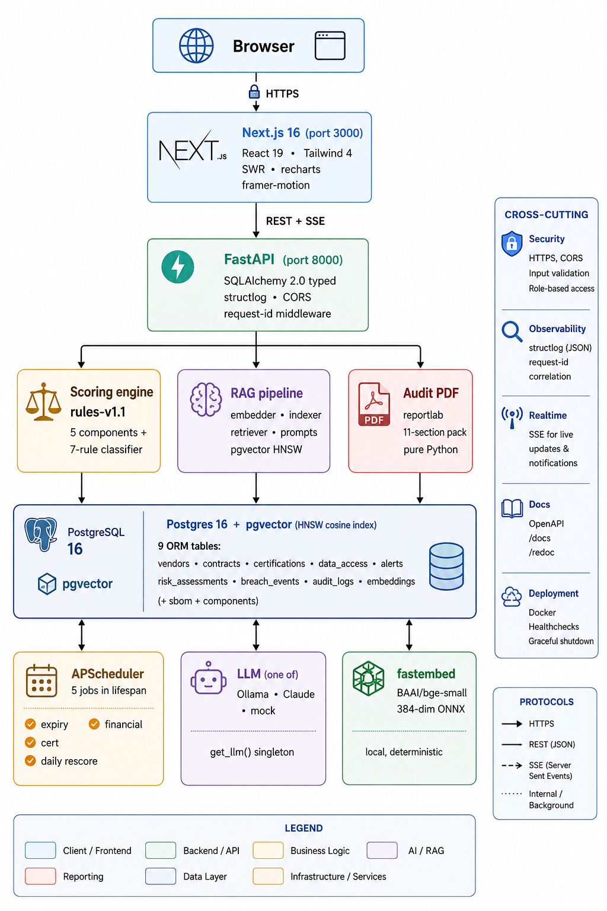

VRM Intelligence is a **Turborepo monorepo** containing three apps and a small set of shared packages. Every dependency is deliberate — no fashion picks.

## System diagram

## Stack

| Layer | Choice | Why |
|---|---|---|
| **Monorepo** | Turborepo + Bun | Fast install, parallel tasks, single repo |
| **Web** | Next.js 16 · React 19 · Tailwind 4 | Latest stable, App Router, type-safe |
| **Animation** | framer-motion 12 | Page transitions, KPI count-ups, gauge sweep, pulsing badges |
| **Charts** | recharts | Donut + bar chart components, native dark mode |
| **State** | SWR | Light, cache-aware, auto-revalidation |
| **API** | FastAPI · SQLAlchemy 2.0 (typed) | Auto OpenAPI, async-native, Pydantic v2 |
| **Logging** | structlog | JSON in prod, pretty console in dev |
| **DB** | Postgres 16 + pgvector | Relational + vector in one instance |
| **Embeddings** | fastembed (BAAI/bge-small-en-v1.5, 384-dim ONNX) | Local, deterministic, ~133 MB cached |
| **LLM** | env-switchable: Ollama / Claude / mock | Single `get_llm()` abstraction |
| **PDF** | reportlab | Pure Python — no Cairo/Pango install pain |
| **Scheduler** | APScheduler (AsyncIO) | In-process; no separate worker needed |
| **Python env** | uv | Fast deps, lockfile-based reproducibility |

## Repo layout

<Files>
  <Folder name="vendor_risk_management" defaultOpen>
    <Folder name="apps">
      <Folder name="api">
        <Folder name="src/vrm_api">
          <File name="main.py — FastAPI entrypoint, CORS, lifespan, request-id" />
          <Folder name="models — 9 SQLAlchemy ORM tables" />
          <Folder name="routers — /vendors /risk /ask /alerts /contracts /audit /sbom" />
          <Folder name="scoring — engine, components, rules, evaluator, narratives" />
          <Folder name="rag — embedder, indexer, retriever, prompts" />
          <Folder name="services — scheduler, breach_feed, financial_scraper, audit_pack, warmup" />
          <Folder name="llm — base, claude, ollama, mock, factory" />
        </Folder>
      </Folder>
      <Folder name="web">
        <Folder name="app — Next.js routes (/, /vendors, /alerts, /ask, /eval, /audit)" />
        <Folder name="components — Sidebar, Topbar, RiskGauge, SeverityDonut, SupplyChainCard, etc." />
        <Folder name="lib/api — typed client, SWR hooks" />
      </Folder>
      <Folder name="docs">
        <File name="this Fumadocs site" />
      </Folder>
    </Folder>
    <Folder name="data">
      <File name="generate_mock_data.py — seed=42, 400 vendors" />
      <File name="vendor_registry.csv — bulk seed" />
      <File name="vendor_labels.csv — ground truth" />
      <File name="breach_feed.json — mock HIBP / CISA-KEV" />
      <File name="financial_signals.json — mock Bloomberg / DnB" />
      <File name="cert_verifications.json — mock AICPA / BSI" />
      <Folder name="contracts — sample MSAs for upload demo" />
      <Folder name="sboms — sample CycloneDX with planted log4j CVE" />
    </Folder>
    <Folder name="infra/postgres/init">
      <File name="00_extensions.sql — vector, pg_trgm, pgcrypto" />
    </Folder>
    <File name="docker-compose.yml — Postgres + pgvector + API" />
    <File name="Makefile — one-command ops" />
    <File name=".env.example — every variable documented" />
  </Folder>
</Files>

## Key design decisions

<Cards>
  <Card title="Data model" href="/docs/architecture/data-model">
    9 ORM tables. Why each one exists, and how they compose into the scoring inputs.
  </Card>
  <Card title="LLM provider abstraction" href="/docs/architecture/llm-providers">
    Single `get_llm()` factory. Provider selection lives in one env var.
  </Card>
</Cards>

## Non-obvious choices worth justifying

<Callout type="info" title="Why fastembed, not Ollama, for embeddings?">
Ollama's `/api/embeddings` endpoint isn't exposed in the default daemon install. Rather than make every user `--embeddings`-toggle their Ollama, we use **fastembed** (BAAI/bge-small-en-v1.5, 384-dim ONNX). It runs offline, is deterministic, and works regardless of which LLM provider is configured.
</Callout>

<Callout type="info" title="Why reportlab, not weasyprint, for PDFs?">
weasyprint produces beautiful HTML→PDF output but requires **Cairo** and **Pango** system libraries — painful on macOS. **reportlab** is pure Python, zero system deps, installs in 10 seconds, and the styled Platypus API gives us 95% of weasyprint's polish at 5% of the install pain.
</Callout>

<Callout type="info" title="Why pgvector, not a separate vector DB?">
Pinecone / Weaviate / Qdrant add a second database, second backup story, second network hop. With 400 vendors and a 384-dim embedding, **pgvector + HNSW cosine** is faster than any hosted vector DB and lives in the same Postgres instance we already need.
</Callout>

<Callout type="info" title="Why APScheduler inside the FastAPI process?">
A separate Celery / RQ worker means a second deployable, broker (Redis), and lifecycle management. **APScheduler started in the FastAPI lifespan** keeps the deployment story to one Docker container. The 5 jobs are short, idempotent, and don't need horizontal scaling.
</Callout>
